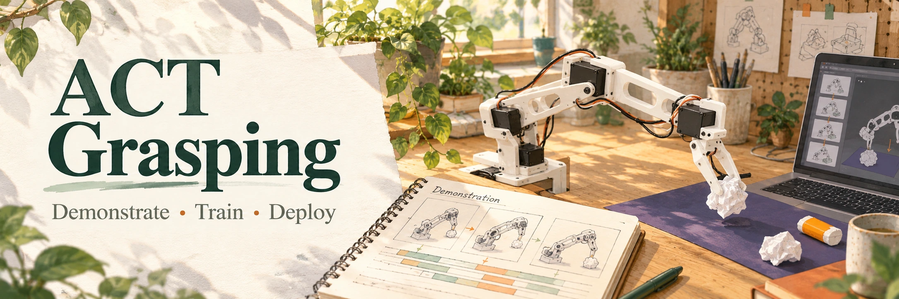
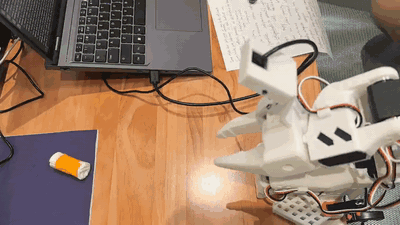
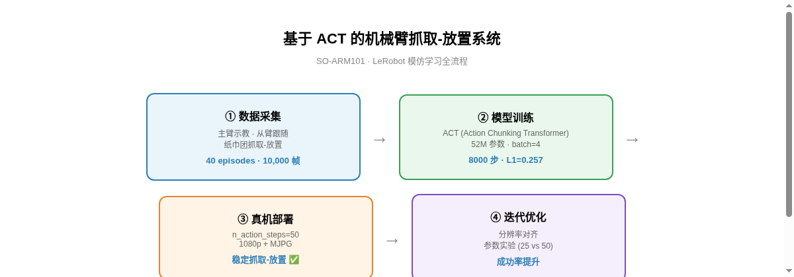

# SO-ARM101 · ACT Grasping



[](LICENSE)

[](https://oye-li-bc.github.io/)

基于 ACT (Action Chunking Transformer) 的机械臂抓取-放置系统，运行在 SO-ARM101 六自由度机械臂上，使用 LeRobot 框架完成从数据采集到真机部署的完整模仿学习闭环。

**[演示效果](#demo) · [实验记录](#results) · [快速复现](#quickstart) · [技术文档](#docs)**

<a id="demo"></a>

## 🎥 演示效果



> 演示：SO-ARM101 从臂抓取纸巾团并放置到目标位置（手机实拍，0-10s）

<a id="results"></a>

## 📊 成果概览

- **任务**：SO-ARM101 从臂抓取纸巾团并放置到目标位置
- **数据**：40 条示教轨迹，10,000 帧（25 FPS，1080p）
- **模型**：ACT（52M 参数），8000 步训练
- **性能**：L1 Loss = 0.257，KL Loss = 0.015，真机稳定抓取-放置 ✅

## 🏗️ 技术方案

```
数据采集(示教) → 模型训练(ACT) → 真机部署 → 迭代优化
```



### 训练曲线


## 📁 目录结构

```
so101-act-grasping/
├── docs/          # 技术文档（数据采集/训练/部署/实验记录）
├── scripts/       # 训练、部署、录制、数据分析脚本
├── results/       # 训练曲线、演示视频
├── data/          # 数据集说明（权重和数据集托管在 HuggingFace）
└── assets/        # README 配图
```

<a id="quickstart"></a>

## 🚀 快速复现

### 1. 录制数据

```bash
lerobot-record \
    --dataset.repo_id=oye-Li-bc/oye_tissue \
    --dataset.num_episodes=40 \
    --dataset.episode_time_s=20 \
    --dataset.reset_time_s=5 \
    --dataset.fps=25 \
    --teleop.type=so101_leader \
    --teleop.port=/dev/ttyACM1 \
    --teleop.id=oye_leader_arm \
    --robot.type=so101_follower \
    --robot.id=oye_follower_arm \
    --robot.port=/dev/ttyACM0 \
    --robot.cameras="{ front: {type: opencv, index_or_path: /dev/video2, width: 1920, height: 1080, fps: 25, fourcc: \"MJPG\"}}" \
    --display_data=true
```

### 2. 训练

```bash
PYTORCH_CUDA_ALLOC_CONF=expandable_segments:True lerobot-train \
    --policy.type=act \
    --dataset.repo_id=oye-Li-bc/oye_tissue_20260815_133841 \
    --steps=8000 \
    --batch_size=4 \
    --output_dir=./oye_tissue_full \
    --policy.n_action_steps=50 \
    --policy.push_to_hub=false \
    --save_freq=2000
```

### 3. 部署

```bash
PYTHONPATH="" lerobot-rollout \
    --policy.type=act \
    --policy.pretrained_path=./oye_tissue_full/checkpoints/008000/pretrained_model \
    --policy.input_features="{ observation.state: {type: STATE, shape: [6]}, observation.images.front: {type: VISUAL, shape: [3, 1080, 1920]} }" \
    --policy.output_features="{ action: {type: ACTION, shape: [6]} }" \
    --policy.n_action_steps=50 \
    --robot.type=so101_follower \
    --robot.id=oye_follower_arm \
    --robot.port=/dev/ttyACM0 \
    --robot.cameras="{ front: {type: opencv, index_or_path: /dev/video2, width: 1920, height: 1080, fps: 25, fourcc: \"MJPG\"}}" \
    --display_data=true
```

## 🔧 关键工程细节

- **分辨率对齐**：部署相机必须与训练数据同分辨率（1920×1080），否则模型会误判距离
- **fourcc MJPG**：1080p 下必须用 MJPG 压缩格式，否则回退 YUYV 仅 5 FPS
- **n_action_steps**：50（2 秒/块），实验证明衔接平滑度收益 > 矫正频率收益

<a id="docs"></a>

## 📚 文档索引

- [docs/01-项目概述.md](docs/01-项目概述.md)
- [docs/02-数据采集.md](docs/02-数据采集.md)
- [docs/03-模型训练.md](docs/03-模型训练.md)
- [docs/04-部署与迭代.md](docs/04-部署与迭代.md)
- [docs/05-实验记录.md](docs/05-实验记录.md)

## 📦 模型与数据集

- 数据集：`oye-Li-bc/oye_tissue_20260815_133841`（HuggingFace）
- 模型权重：`oye-Li-bc/oye_tissue_act`（HuggingFace）

## 🧰 环境

- LeRobot 0.6.1 · PyTorch · CUDA 13.0
- RTX 5070 Ti 11.5GB
- SO-ARM101（主臂示教 + 从臂执行）

## 📄 License

MIT

## 同系列项目

- [SO-ARM101 · SmolVLA Grasping](https://github.com/oye-Li-bc/so101-smolvla-grasping)
- [SO-ARM101 · HIL-SERL Pushing](https://github.com/oye-Li-bc/so101-hilserl-pushing)

---

[个人作品集](https://oye-li-bc.github.io/) · [封面来源与配图说明](.github/readme/README.md)
