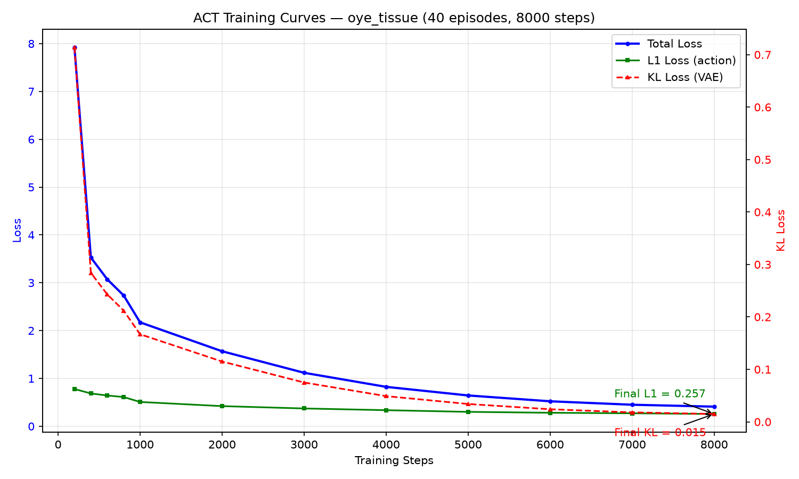

# 03 模型训练

## 1. 策略选择：ACT

**Action Chunking Transformer（ACT）** 的核心思想：一次输入当前观测，预测未来 N 步动作（动作分块），而非逐步预测。

### 为什么用 ACT

| 问题 | 逐步预测 | ACT（分块预测） |
|------|------|------|
| 累积误差 | 每步误差叠加 → 抖动 | 块内无累积误差 → 流畅 |
| 推理频率 | 每帧一次 | 每 N 步一次 |
| 平滑性 | 差 | 好 |

### ACT 架构（52M 参数）

```
输入（1 帧）
  ├─ 图片 → ResNet18 → 512 维特征（11M 参数）   ← 视觉感知
  ├─ 关节 → Linear → 512 维特征                 ← 本体感知
  └─ 融合 → CVAE 编码 → 32 维潜在表示（9M）      ← 信息压缩
           → Transformer 解码 → 100 步动作（30M） ← 动作规划
```

## 2. 训练配置

### 命令

```bash
PYTORCH_CUDA_ALLOC_CONF=expandable_segments:True lerobot-train \
    --policy.type=act \
    --dataset.repo_id=oye-Li-bc/oye_tissue_20260815_133841 \
    --steps=8000 \
    --batch_size=4 \
    --output_dir=./oye_tissue_full \
    --policy.n_action_steps=50 \
    --policy.push_to_hub=false \
    --save_freq=2000
```

### 关键参数

| 参数 | 值 | 选择理由 |
|------|------|------|
| steps | 8000 | 40 条数据（2500 步/epoch），约 3.2 个 epoch |
| batch_size | 4 | 显存约束下最大化（1080p 图：2→4.9GB，4→9.2GB，8→OOM） |
| n_action_steps | 50 | 2 秒/块，实验验证的最佳值（见 05-实验记录） |
| lr | 1e-5 | ACT 默认，无需调整 |
| push_to_hub | false | 避免网络超时导致训练崩溃 |

## 3. Loss 构成

ACT 的总 Loss = L1 Loss + KL Loss × 10

| Loss | 含义 | 初始值 | 最终值 |
|------|------|------|------|
| **L1 Loss** | 预测动作 vs 示教动作的平均绝对偏差（6 关节均值） | 0.779 | **0.257** |
| **KL Loss** | CVAE 潜在分布与标准正态的偏离（输出稳定性） | 0.714 | **0.015** |
| **Total** | 综合 | 7.923 | **0.410** |

## 4. 训练曲线分析



曲线呈标准的**快速下降 → 缓慢收敛**形态：

| 阶段 | 步数 | 特点 |
|------|------|------|
| 快速学习 | 0 - 2000 | Loss 从 7.9 骤降至 2.0，模型学习基础动作 |
| 精细调整 | 2000 - 6000 | Loss 降至 0.5，动作精细化 |
| 收敛 | 6000 - 8000 | 曲线趋平，L1=0.257，KL=0.015 |

## 5. 训练中的工程问题与解决

| 问题 | 原因 | 解决 |
|------|------|------|
| OOM | 1080p 图 + batch=8 超出 11.5GB 显存 | batch_size 降到 4 |
| checkpoint 保存崩溃 | LeRobot 0.6.1 normalization bug | 修复 `NormalizerProcessorStep.state_dict/load_state_dict` |
| push 超时崩溃 | 网络无法访问 HuggingFace | `--policy.push_to_hub=false` |

## 6. 硬件环境

- GPU：RTX 5070 Ti 11.5GB（BIOS 锁定 65W，训练速度受限但不影响模型质量）
- 训练时长：约 40 分钟（8000 步）
- 显存占用：9.23GB / 11.5GB
